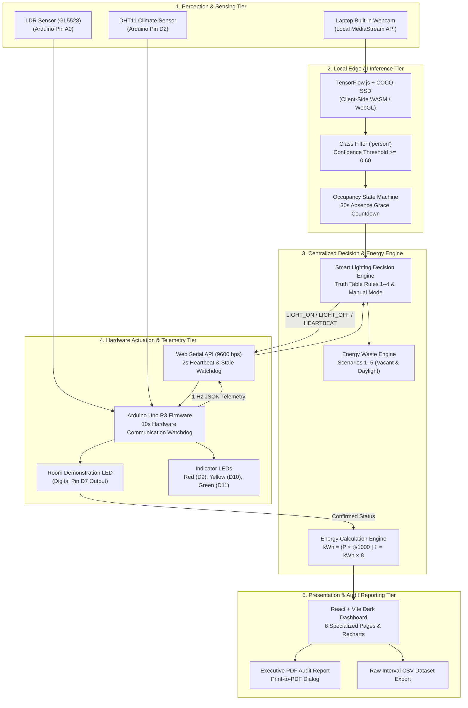
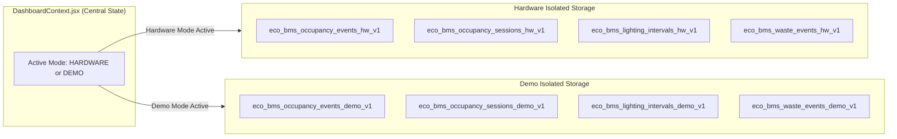

# Project Architecture & Workflow Specification

## Smart Building Energy Waste Detection & Sustainability Monitoring System

---

## 1. Executive System Overview

The **Smart Building Energy Waste Detection & Sustainability Monitoring System** is an end-to-end, multi-tier cyber-physical IoT and AI platform designed to eliminate unnecessary electrical energy waste in commercial and educational facilities.

The system combines:
1. **Client-side Computer Vision (AI):** Real-time person presence detection via laptop built-in webcam using TensorFlow.js and COCO-SSD (zero video/frame upload or external server dependencies).
2. **Physical IoT Microcontroller Tier:** Arduino Uno R3 sampling ambient daylight (LDR on A0), temperature/humidity (DHT11 on D2), and actuating a physical room luminaire demonstration on Digital Pin D7.
3. **Bidirectional Web Serial Communication:** Browser-native Web Serial API (`navigator.serial`) at 9600 baud with a 2-second heartbeat and a 10-second hardware watchdog.
4. **Intelligent Conservation Decision Engine:** Real-time algorithmic truth-table logic aligning luminaire actuation with ambient daylight and verified occupancy.
5. **Advanced Energy Analytics Tier:** Mathematical energy consumption (kWh) and electricity cost (₹) calculation for configured 9 W LED rating and ₹8.00/kWh tariff.
6. **Audit & Sustainability Reporting:** Automated PDF printable reports and CSV dataset exports with complete mode separation between Hardware and Demo environments.

---

## 2. End-to-End Architectural Pipeline

---

## 3. Layered Component Breakdown

### Layer 1: Computer Vision & AI Presence Detection
- **Model:** TensorFlow.js with the lightweight COCO-SSD object detection model running completely inside the user's browser.
- **Filtering:** Predictions are strictly filtered for `class === 'person'` with confidence scores $\ge 0.60$ (configurable in the UI).
- **Sequence Protection:** Asynchronous inference results are dropped if their sequence sequence number is older than the latest completed frame, eliminating race conditions.
- **Absence Grace Period (30s):**
  - When a person is detected, occupancy transitions immediately to `OCCUPIED`.
  - When a person temporarily disappears, an absence timer initiates a **30-second grace countdown**.
  - If the occupant returns within 30 seconds, the countdown is immediately aborted and reset to 30s.
  - If the space remains vacant for the full 30 seconds, the state transitions to `UNOCCUPIED`, automatically de-energizing Pin D7.

### Layer 2: Microcontroller & Web Serial Layer
- **Arduino Uno R3:** Connected via USB. Runs non-blocking firmware ([hardware/smart_building_controller/smart_building_controller.ino](file:///c:/Users/jitu-vamsi/Downloads/Mukilan%20Project/hardware/smart_building_controller/smart_building_controller.ino)).
- **Pin Configuration:**
  - `A0`: Analog input for LDR photoresistor (0–1023 ADC).
  - `D2`: Digital single-wire bus for DHT11 temperature/humidity.
  - `D7`: **EXCLUSIVELY dedicated digital output for Room LED.**
  - `D9`: Digital output for Red Alert LED (Active energy waste).
  - `D10`: Digital output for Yellow Advisory LED (Climate advisory / Unknown state).
  - `D11`: Digital output for Green Efficiency LED (Optimal daylight conservation).
- **Watchdog Protection:**
  - Browser dispatches `{"command":"HEARTBEAT"}` every 2 seconds.
  - If serial communication drops for $>10$ seconds, the Arduino firmware automatically shuts off Pin D7 to prevent unattended power waste.

### Layer 3: Energy Calculation & Analytics Engine
- **Centralized Config:** [src/config/energyConfig.js](file:///c:/Users/jitu-vamsi/Downloads/Mukilan%20Project/src/config/energyConfig.js) stores rated power (default 9 W) and electricity tariff (default ₹8.00/kWh).
- **Interval Tracking:** [src/services/lightingHistoryService.js](file:///c:/Users/jitu-vamsi/Downloads/Mukilan%20Project/src/services/lightingHistoryService.js) measures confirmed Pin D7 ON/OFF runtimes with sub-second accuracy.
- **Calculation Formulas:**
  $$\text{Energy (kWh)} = \frac{\text{Watts} \times \text{Hours}}{1000}$$
  $$\text{Cost (₹)} = \text{Energy (kWh)} \times \text{Tariff (₹/kWh)}$$
- **Avoidable Waste:** Categorizes avoidable energy from vacant room burning and daylight overload.
- **Baseline Savings:** Compares automated operation against a theoretical 10-hour commercial office baseline.

---

## 4. State Management & Mode Isolation

- When switching modes via the top navigation bar, the application swaps storage pointers instantly.
- Demo simulation routines do not write to hardware storage keys.
- Hardware telemetry packets do not write to demo storage keys.
- Browser refreshes reload records from their respective isolated stores.
